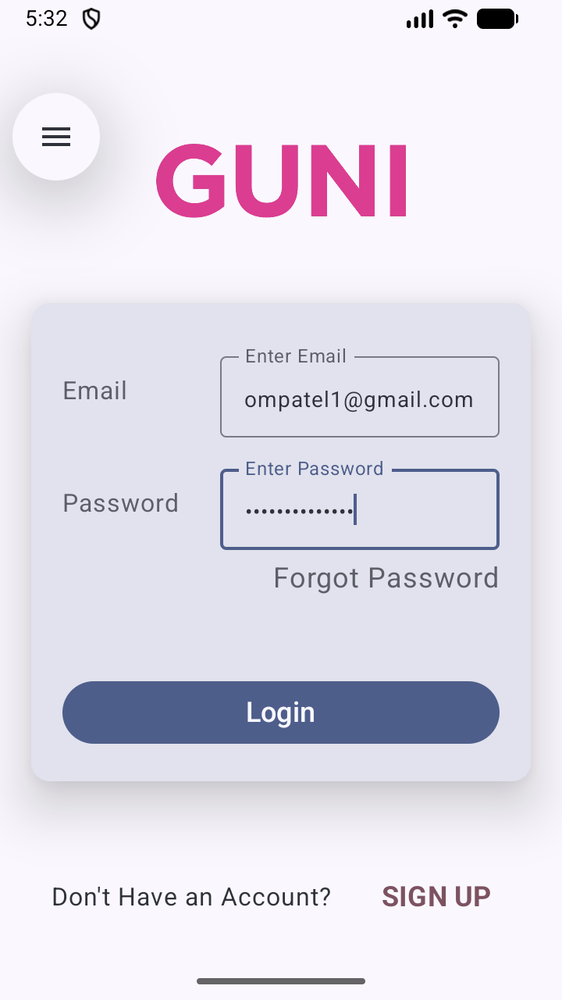
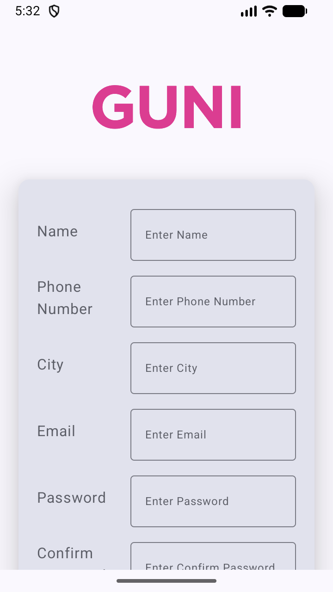
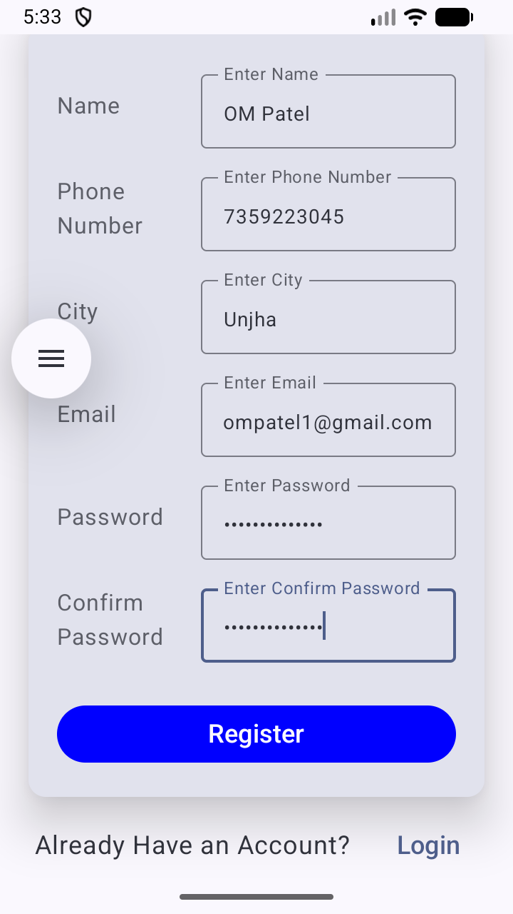

# MAD Practical 5: Login & Registration Screens with Jetpack Compose

## 🎯 Aim
Create an Android Application that includes **Login** and **Registration** screens using **Jetpack Compose** and **Jetpack Navigation Compose**.

---

## 📱 App Overview & Architecture

This application demonstrates modern Android UI development using **Jetpack Compose** (Material 3) adhering to Unidirectional Data Flow (UDF) state hoisting principles. The app provides a smooth, declarative transition between authentication flows (Login and Registration) with robust input validation and reusable components.

---
# Screenshots

|  |  |  |
| :---: | :---: | :---: |
|  |  |  |


## 📁 Detailed Project Structure

```text
app/src/main/java/com/example/a24012011117_mad_practical_5/
├── MainActivity.kt         # Entry point activity initializing Edge-to-Edge and setContent
├── AppNavigation.kt        # Navigation graph setup (NavHost, composable routes)
├── LoginScreen.kt          # Login UI with Email, Password, Forgot Password, and Sign Up links
├── RegisterScreen.kt       # Registration UI with Name, Phone, City, Email, Password, Confirm Password
├── FormField.kt            # Highly reusable form input field supporting validation & types
└── ui/theme/               # Material 3 Design System Styling
    ├── Color.kt            # Custom color palettes (Purple80, Pink40, etc.)
    ├── Theme.kt            # Dynamic color support (Android 12+) and dark/light palettes
    └── Type.kt             # Material 3 typography and text styles
```

---

## ⚙️ Key Jetpack Compose Components & APIs Used

1. **`NavHost` & `rememberNavController()`**:
   - Manages navigation state across screens (`login` and `register` routes) without fragment boilerplate.
2. **`OutlinedTextField`**:
   - Provides Material 3 outlined input boxes for user data entry with built-in labels and single-line constraints.
3. **`PasswordVisualTransformation` & `KeyboardOptions`**:
   - Secures password text input and optimizes the on-screen software keyboard (e.g., `KeyboardType.Password`, `KeyboardType.Number`, `KeyboardType.Email`).
4. **`Card` & `CardDefaults`**:
   - Wraps form inputs inside elevated cards (`defaultElevation = 20.dp`) with medium rounded corners (`MaterialTheme.shapes.medium`).
5. **`verticalScroll(rememberScrollState())`**:
   - Ensures forms remain fully accessible and scrollable on smaller screens or when the software keyboard is active (`adjustResize`).
6. **State Hoisting (`mutableStateOf` & `remember`)**:
   - Manages text field states reactively across user interactions.

---
## Features

- Login screen with email and password fields.
- Registration screen with name, phone number, city, email, password, and confirm-password fields.
- Reusable `FormField` composable for consistent input fields.
- Password masking using `PasswordVisualTransformation`.
- Numeric keyboard and digit-only input filtering for the phone-number field.
- Screen navigation using Navigation Compose.
- Scrollable forms to support smaller screens.
- Material 3 components, a custom theme, and a university logo image.
- Toast messages when Login or Register is tapped.


## 🚀 Detailed Working & User Flow

### 1. **Launch & Navigation Setup (`MainActivity.kt` & `AppNavigation.kt`)**
- `MainActivity` sets up Edge-to-Edge display (`enableEdgeToEdge()`) and hosts `AppNavigation`.
- `AppNavigation` defines the navigation graph:
  - **Start Destination**: `"login"`
  - **Routes**:
    - `"login"` ➔ Navigates to `LoginScreen`
    - `"register"` ➔ Navigates to `RegisterScreen`

### 2. **Login Screen (`LoginScreen.kt`)**
- Displays the university/app logo image (`guni_pink_logo`).
- Contains a form card with:
  - Email input field.
  - Password input field (masked).
  - "Forgot Password" text action.
  - Primary "Login" button (triggers a Toast notification on click).
- Bottom row provides navigation to the Registration screen when tapping **"Don't Have an Account?"** or **"SIGN UP"**.

### 3. **Registration Screen (`RegisterScreen.kt`)**
- Contains an expanded form card for new user onboarding:
  - Full Name, Phone Number (with numeric digit filtering), City, Email, Password, and Confirm Password.
- Primary "Register" button triggers a Toast notification.
- Bottom row allows returning to the Login screen via **"Already Have an Account?"** or **"Login"**.

---

## 💻 Code Implementation Highlights

### Reusable Form Field (`FormField.kt`)
```kotlin
@Composable
fun FormField(
    label: String,
    textState: String,
    onTextChange: (String) -> Unit,
    isPasswordField: Boolean = false,
    isNumber: Boolean = false
) {
    Row(
        modifier = Modifier
            .fillMaxWidth()
            .padding(vertical = 6.dp),
        horizontalArrangement = Arrangement.SpaceBetween,
        verticalAlignment = Alignment.CenterVertically
    ) {
        Text(text = label, fontSize = 16.sp, modifier = Modifier.weight(0.9f))

        OutlinedTextField(
            value = textState,
            onValueChange = { newValue ->
                if (!isNumber || newValue.all { it.isDigit() }) {
                    onTextChange(newValue)
                }
            },
            modifier = Modifier.weight(1.6f).height(60.dp),
            visualTransformation = if (isPasswordField) PasswordVisualTransformation() else VisualTransformation.None,
            singleLine = true,
            keyboardOptions = KeyboardOptions(
                keyboardType = when {
                    isPasswordField -> KeyboardType.Password
                    isNumber -> KeyboardType.Number
                    label == "Email" -> KeyboardType.Email
                    else -> KeyboardType.Text
                }
            )
        )
    }
}
```
## Important Concepts Explained

### 1. Jetpack Compose and declarative UI

**Jetpack Compose** is Android's modern toolkit for building native interfaces with Kotlin. Instead of creating most of the interface in XML layouts, you describe the UI in Kotlin using composable functions. Compose updates the screen when the state used by the UI changes.

A function annotated with `@Composable` can describe a part of the interface, such as a screen, text label, button, or form field.

### 2. `setContent` and `MainActivity`

`MainActivity.kt` is the app's entry point. In `onCreate()`, `setContent { ... }` starts the Compose UI. The app theme is applied around a `Surface`, and `AppNavigation` is displayed inside it. `enableEdgeToEdge()` enables edge-to-edge window layout, while `safeDrawingPadding()` helps keep content within safe drawing areas.

### 3. State management: `remember` and `mutableStateOf`

The Login screen stores the email and password, while the Registration screen stores the name, phone number, city, email, password, and confirmation password.

```kotlin
var email by remember { mutableStateOf("") }
```

- `mutableStateOf("")` creates observable state with an initial empty string.
- `remember` retains that state across recompositions while the composable remains in the composition.
- `by` delegates access to the stored value, so the variable can be read and assigned directly.
- When the state changes, Compose recomposes the parts of the UI that depend on it.

### 4. Reusable composables and state hoisting

`FormField.kt` defines a reusable `FormField` composable. Instead of writing a separate text field implementation for every form entry, the screens call the same composable with different labels and settings.

The field receives its current value (`textState`) and a callback (`onTextChange`) from its parent screen. This is an example of **state hoisting**: the screen owns the state, and the reusable field reports user changes through a callback. This keeps the UI component reusable and easier to maintain.

### 5. `OutlinedTextField` and keyboard options

`OutlinedTextField` displays the input box with a label. `KeyboardOptions` requests a suitable keyboard type:

- `KeyboardType.Email` for the Email field.
- `KeyboardType.Password` for password fields.
- `KeyboardType.Number` for the Phone Number field.
- `KeyboardType.Text` for regular text fields.

The phone-number field also checks `newValue.all { it.isDigit() }` before accepting the input, so non-digit characters are rejected. The project does not currently perform full validation for email format, empty fields, password strength, or whether the two passwords match.

### 6. Hiding password text

When `isPasswordField` is true, `FormField` uses `PasswordVisualTransformation()`. This displays masked characters instead of showing the password as plain text. `VisualTransformation.None` is used for fields that are not password fields.

### 7. Layouts and `Modifier`

Compose layouts arrange the screen's elements:

- `Column` places elements vertically.
- `Row` places elements horizontally.
- `Spacer` adds empty space between elements.
- `Modifier.fillMaxSize()` and `fillMaxWidth()` control the available space.
- `padding()` adds spacing around content.
- `height()` and `width()` set dimensions.
- `align()` positions content within its parent layout.
- `verticalScroll(rememberScrollState())` makes the forms scrollable when their content is taller than the screen.

A `Modifier` can be chained to describe layout, appearance, interaction, and other behavior for a composable.

### 8. Material 3 components and cards

The project uses Material 3 components such as `Button`, `TextButton`, `OutlinedTextField`, `Card`, and `MaterialTheme`. The login and registration forms are placed inside cards with padding, rounded shapes, and elevation to visually group the fields.

`Theme.kt`, `Color.kt`, and `Type.kt` centralize the app's color scheme and typography. The theme can use system dark mode and Android 12+ dynamic colors when available.

### 9. Navigation Compose

`AppNavigation.kt` creates a navigation controller with `rememberNavController()` and defines the available screens inside `NavHost`.

- **Start destination:** `login`
- **Route `login`:** displays `LoginScreen`
- **Route `register`:** displays `RegisterScreen`

Calling `navController.navigate("register")` opens the Registration screen. Calling `navController.navigate("login")` returns to the Login screen. These routes change which composable screen is displayed without requiring a separate Activity for each screen.

### 10. Toast messages

A **Toast** is a brief message displayed on the screen. In this practical, tapping Login displays `Login Clicked`, and tapping Register displays `Register Clicked`. These messages demonstrate button click handling; they are not proof that login or registration succeeded.

### 11. Image resources and previews

The screens load the logo from `res/drawable/guni_pink_logo.png` using `painterResource()`. The `@Preview`-annotated functions in `LoginScreen.kt`, `RegisterScreen.kt`, and `FormField.kt` allow components to be previewed in Android Studio without launching the app on a device.


---

**Enrollment No:** 24012011117  
**Practical:** 05
